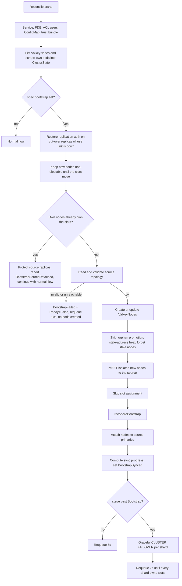
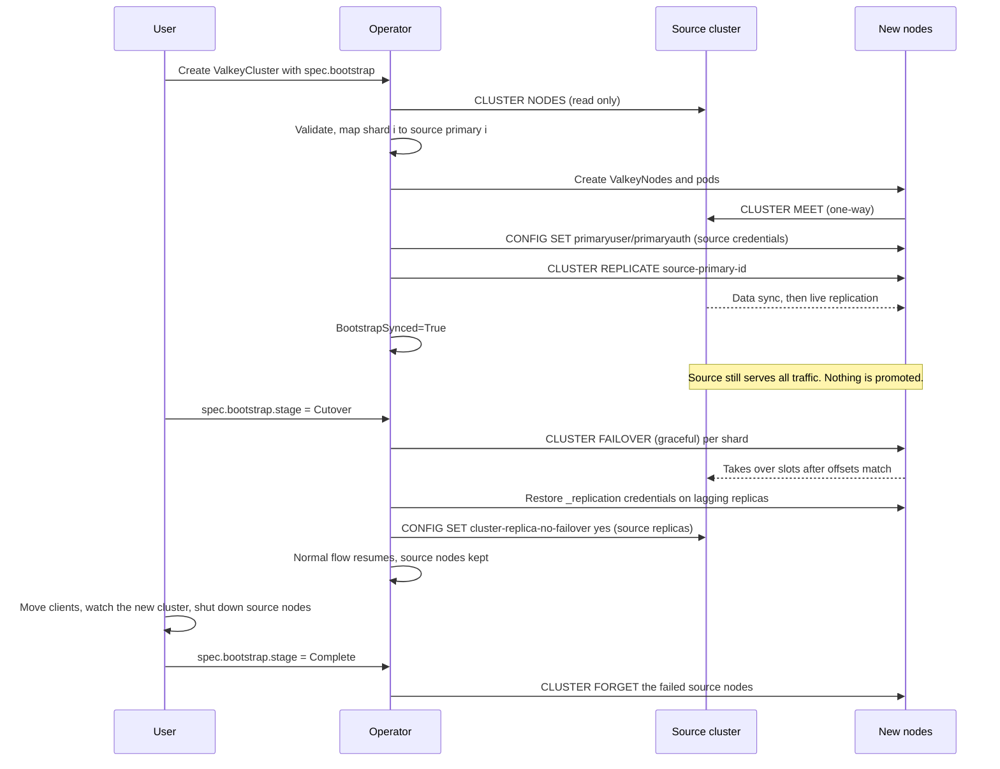

# Bootstrapping a ValkeyCluster from an existing cluster

Design and behaviour of the bootstrap feature for [#696](https://github.com/valkey-io/valkey-operator/issues/696). It describes what is implemented on the `feat/cluster-bootstrap-poc` branch and why, with the open questions at the end.

Status: **proof of concept**. The API is provisional. The agreed scope on the issue is Cluster to Cluster first, as a POC, with the API settled afterwards. This version covers equal shard counts only.

## What it does

You have a running Valkey or Redis cluster (VMs, StatefulSets, another operator). You want it managed by this operator, with no downtime and no data loss.

You create a new `ValkeyCluster` with `spec.bootstrap` pointing at the old cluster. The operator then:

1. Starts new Valkey pods.
2. Makes each of them a **replica** of one of the old cluster's primaries, so the old cluster keeps serving traffic and the new nodes copy its data.
3. Waits. Nothing is promoted until you decide, and the new nodes cannot be elected primary on their own.
4. When you set `spec.bootstrap.stage: Cutover`, promotes the new nodes with a graceful failover. From then on the new nodes are the primaries and the old nodes are replicas of them. The old nodes cannot be elected primary, and you can still roll back.
5. You point clients at the new cluster and, when you are happy, shut the old nodes down.
6. When you set `spec.bootstrap.stage: Complete`, the operator forgets the old nodes.

Only the `stage` field moves the migration forward. The operator never cuts over or detaches the source on its own.

The key idea is that a Valkey node in cluster mode can only replicate a node of *its own* cluster. So the new nodes **join the source cluster** as replicas. They do not form a separate cluster that copies from it.

## Design decisions

### Why the new nodes join the source cluster

The issue proposes a `Replicate` mode in which each new primary replicates from a source primary. That does not work in cluster mode: a node can only `CLUSTER REPLICATE` a node of its own cluster and cannot `REPLICAOF` an arbitrary external instance. There are two ways to get live sync:

| Option | How it works | Trade-offs |
|---|---|---|
| **A. Join as replicas (implemented)** | New operator-managed nodes `CLUSTER MEET` into the source cluster, replicate its primaries, and are promoted by a graceful `CLUSTER FAILOVER` at cutover. | Native, no data loss, no extra tooling, and it reuses the existing replicate code. The source's node table gains members, the bus ports must be reachable both ways, and the shard counts must match. |
| **B. Separate cluster plus a sync tool** | The target forms its own cluster and a tool such as RedisShake or `valkey-proxy` copies the data. | Handles differing shard counts and needs no network coupling. It adds an external dependency, and consistency and cutover are harder. A possible later option. |

The issue also says the operator never writes to the source. Option A cannot honour that fully, because joining changes the source's node table. The operator never changes source *data*, and it never promotes or forgets source members while bootstrapping, but it does add nodes to the source's membership. This needs maintainer agreement.

Differing shard counts are handled after cutover with the operator's normal scale-out and scale-in, so they are not part of the migration itself.

### Shape of the API

- `endpoints` are seeds, not one per shard. The topology comes from `CLUSTER NODES`.
- There is no `mode` field. A single path is enough for the POC, and `mode` can be added if a snapshot or sync-tool path appears.
- `stage` (`Bootstrap`, `Cutover`, `Complete`) is the only thing that moves the migration, and it only moves forward. It is an enum rather than a boolean, as suggested in review, so the user decides separately when to cut over and when to detach the source.
- The source password is separate from the destination's users, because only the replication handshake and the operator's read of the source use it.

## The API

```yaml
apiVersion: valkey.io/v1alpha1
kind: ValkeyCluster
metadata:
  name: my-cluster
spec:
  shards: 3
  replicasPerShard: 1
  bootstrap:
    source:
      endpoints: ["old-0.ns.svc:6379"]        # seed addresses of source nodes
      passwordSecretRef:                      # optional: the source password
        name: old-auth
        key: password
      tls:                                    # optional: omit for a plaintext source
        caSecretRef:
          name: old-ca
          key: ca.crt
    stage: Bootstrap                          # Bootstrap | Cutover | Complete
```

| Field | Meaning |
|---|---|
| `source.endpoints` | One to sixteen `host:port` seeds, each checked against a simple `host:port` pattern (IPv6 as `[addr]:port`). One reachable endpoint is enough, because the operator reads the full topology with `CLUSTER NODES`. List several for redundancy. They don't need to be on different shards. |
| `source.passwordSecretRef` | A Secret key with the **source** password. Used only to read the source and to authenticate replication from it. It does not need to match the destination's users. |
| `source.tls.caSecretRef` | CA for the operator's own connection to a TLS source. See [limitations](#limitations-and-what-is-not-tested). |
| `stage` | The step the migration is in. Defaults to `Bootstrap`. See [Stages](#stages). |

Validation rules (CEL, enforced by the API server):

- `bootstrap` cannot be added to an existing cluster, and cannot be removed once set.
- `bootstrap.source` is immutable.
- `bootstrap.stage` only moves forward: `Bootstrap` to `Cutover` to `Complete`. A skip from `Bootstrap` straight to `Complete` is allowed and cuts over first.

## Stages

| Stage | What the operator does | Source nodes |
|---|---|---|
| `Bootstrap` (default) | The new nodes join the source as replicas and keep syncing. Nothing is promoted. | Untouched. They keep their own failover behaviour. |
| `Cutover` | Graceful `CLUSTER FAILOVER` per shard, so the new nodes become the primaries. | Stay in the cluster as replicas. The operator sets `cluster-replica-no-failover` on them, so none can be elected primary. You can still roll back. |
| `Complete` | Forgets the source nodes with `CLUSTER FORGET`, through the existing stale-node cleanup. | Removed from the cluster. Shut them down first, or a running node can rejoin. |

### Nothing can be elected by surprise

A replica that wins an automatic election becomes a primary without the user asking. That must not happen to the wrong node, so each stage closes it off:

- **`Bootstrap`:** every new node runs with `cluster-replica-no-failover yes`. The operator renders it into the node config, so even a restarted pod comes back protected. A manual `CLUSTER FAILOVER` still works, which is how cutover promotes a node. The source nodes are not modified, because the source keeps serving traffic and needs its own failover.
- **`Cutover`:** once the new nodes own the slots, the operator turns `cluster-replica-no-failover` off on them live (`CONFIG SET`) so the new cluster has normal failover. It turns it on, also live, for every source node that is still a replica. On the same nodes it sets `masteruser` and `masterauth` to this cluster's replication credentials. The source replicas now follow a new primary, which does not know the source password, so without this their link would go down and there would be nothing to roll back to. None of this is persisted on the source (the operator never runs `CONFIG REWRITE`), so a restarted source node loses it and gets it back on the next reconcile.
- **`Complete`:** the source nodes are forgotten, and the key is dropped from the rendered config. That one change rolls the new pods once, through the normal rolling update.

The config key is the same in `Bootstrap` and `Cutover`, so moving to `Cutover` does not roll any pod.

### Why `Complete` is separate from `Cutover`

After the failover, the old nodes are still replicas in the same Valkey cluster as the new ones. That is what makes rollback possible: if something is wrong, you can fail over back to them. Forgetting them ends that option, so it is its own explicit step. Do it only after you have moved clients, watched the new cluster, and shut the old nodes down.

`CLUSTER FORGET` only bans a node for about a minute. A source node that is still running keeps gossiping and can rejoin. So at `Complete` the operator forgets only source nodes that are failing or unreachable, and the `BootstrapSourceDetached` condition says how many are still in the cluster.

## How "bootstrapping" is decided

The operator stores no phase. Each reconcile derives it from live state:

> A cluster **with `spec.bootstrap`** is bootstrapping until its own nodes own the slots, meaning at least `spec.shards` shards each own slots.

That makes the flow safe across operator restarts and lets it end by itself after cutover. Source nodes are never part of this count, because the operator only scrapes its own pods.

One piece of state is stored. When cutover finishes, the operator leaves `BootstrapSynced=True` with reason `BootstrapComplete`, and from then on the cluster counts as migrated even if the live check would say otherwise. Without it, raising `spec.shards` after cutover would make the new shard look like an unfinished bootstrap, and the operator would try to plan a source that may no longer exist.

## Reconcile flow

The bootstrap logic is a set of branches inside the existing `ValkeyClusterReconciler`. A cluster without `spec.bootstrap` takes exactly the old code path.



### Read and validate the source

Before creating any pod, the operator reads the source:

1. Reads the password and CA Secrets through `APIReader`. This is needed because the manager's cache only holds operator-labelled Secrets.
2. Connects to each endpoint in turn with a short-lived client and runs `CLUSTER NODES`. It uses the first one that answers.
3. Strips the RESP3 `txt:` marker from the reply, then parses it.
4. Runs `PlanBootstrapSource`, which rejects the source if:
   - it has no primaries owning slots,
   - a primary is failing or has no address,
   - any slot is migrating or importing,
   - fewer than all 16384 slots are covered,
   - the number of source primaries differs from `spec.shards`.
5. Orders the source primaries by their first slot. **Target shard `i` replicates source primary `i`.** The order is deterministic, so the mapping is the same on every reconcile.
6. Resolves the seed host to an IP, because `CLUSTER MEET` takes an IP.

If any of this fails the operator sets `BootstrapFailed=True` and `Ready=False` with the reason, emits a warning event, and retries in 10 seconds. It stops before creating nodes, so a bad source never causes pods to start. The source is only ever read in this step.

### Create the nodes

The existing code creates one `ValkeyNode` per (shard, node-index), as for any cluster. The new pods start isolated: each is a lone cluster-mode primary with no slots.

### Join the source (MEET)

`meetIsolatedToSource` makes every isolated new node run `CLUSTER MEET <seed-ip> <seed-port>`. Gossip then introduces the rest of the source cluster. Differences from the normal `meetIsolatedNodes`:

- It is **one-way**. The new node reaches out, and the source is never told to MEET anything.
- It does **not** set config epochs. Replicas take no part in epoch contests.

### Skipped steps

While bootstrapping, the operator deliberately does not run:

| Skipped | Why |
|---|---|
| Slot assignment (`assignSlotsToPendingPrimaries`) | The source owns all 16384 slots. Assigning slots would create a second, conflicting cluster. |
| `promoteOrphanedReplicas` | A `TAKEOVER` here would promote a node without the user asking. A dead source primary is not ours to replace. |
| `forgetStaleNodes` and `healStaleAddressPeers` | They would treat source members as foreign and could `CLUSTER FORGET` a failing source node. `forgetStaleNodes` also stays off through `Cutover`, and runs only at `Complete`, so a stopped source node is not forgotten while rollback is still possible. |
| The normal replica phase | It looks for primaries inside the new cluster, and there are none yet. |
| The health checks at the end of reconcile | They assume the operator owns every slot. |

### Attach to the source primaries

For each non-isolated pending node, `replicateToSource`:

1. Finds the node's shard index from its pod labels.
2. Runs `CONFIG SET primaryuser ""` and `CONFIG SET primaryauth <source password>` on the node.
3. Runs `CLUSTER REPLICATE <source primary ID>`. This reuses `issueReplicate`, the same function the normal path uses. If gossip hasn't delivered the primary yet ("Unknown node"), it retries on the next reconcile.

**Why step 2 exists.** Every new node starts with `--primaryuser _replication --primaryauth $(PRIMARY_AUTH)`, which are the destination's own credentials. The source would reject them, and the replica could never sync. Both settings are live, so no pod rolls.

All six nodes (primary and replicas of each new shard) become replicas of the *same* source primary. Valkey does not allow a replica of a replica.

### Report sync progress

For each source primary the operator counts the new nodes whose own entry names it as their primary. A shard is **in sync** when it has `1 + replicasPerShard` such nodes and every one has `master_link_status:up` and is not in an initial sync.

| Result | Condition set |
|---|---|
| All shards in sync | `BootstrapSynced=True` (reason `BootstrapSynced`). The message says to set the stage to `Cutover`. |
| Some shards not yet | `BootstrapSynced=False` (reason `BootstrapSyncing`), with "N of M shards in sync". |
| Always while bootstrapping | `Ready=False` and `Progressing=True`, reason `Bootstrapping`. |

"In sync" here means the replication link is up and the initial transfer finished. It does not compare offsets against the source primary, so it says nothing about how far behind a live source is. The graceful failover in the next step handles the final catch-up.

### Cutover

Cutover only runs when `spec.bootstrap.stage` is past `Bootstrap`. Nothing else in the operator promotes a bootstrapping node.

A graceful failover takes a few seconds, and asking again while it runs restarts it. The operator remembers, in memory, when it last asked each replica and waits 15 seconds before asking that replica again. After an operator restart it simply asks once more.

`bootstrapCutover` goes through every shard that does not yet own slots and:

1. Takes the new nodes of that shard whose link is up.
2. Picks the one with the highest replication offset (`HighestOffsetReplica`).
3. Runs a graceful `CLUSTER FAILOVER` on it. The replica pauses the source primary, waits to match its offset, then takes over. Because of that wait, **no acknowledged write is lost**.

If the stage is moved before sync finishes, shards with no synced replica are skipped and retried every 2 seconds, so cutover proceeds as each shard becomes ready.

### After cutover

Once each shard's new primary owns its slots, the next reconcile finds that the bootstrap is migrated. The operator then:

- marks `BootstrapSynced` as complete and removes `BootstrapFailed`,
- turns normal failover back on for the new nodes and turns it off for the source replicas (see [Stages](#stages)),
- sets `BootstrapSourceDetached=False` with the number of source nodes still in the cluster,
- stops validating the source, which may now be shut down,
- runs the normal flow again. `forgetStaleNodes` stays off until the stage is `Complete`.

The other new replicas of each shard follow the new primary automatically. They still carry the source password in `primaryauth`, which the new primary doesn't accept. `restoreReplicationAuth` fixes that: for every cut-over shard, any replica whose link is down gets `primaryuser _replication` and `primaryauth <replication password>` back through `CONFIG SET`.

The old source nodes become replicas of the new primaries and stay in the table. Once they are shut down they show up as failing, and at stage `Complete` the existing `forgetStaleNodes` forgets them.

## End-to-end timeline



## Status and events

Conditions on the ValkeyCluster:

| Condition | Meaning |
|---|---|
| `BootstrapFailed=True` | The source can't be used. Read the message: unreachable, bad password, bad CA, shard count mismatch, unhealthy source, and so on. No pods are created while it is set. |
| `BootstrapSynced=False` | Nodes are attaching or syncing. The message gives "N of M shards in sync". |
| `BootstrapSynced=True` | Every shard is in sync. Safe to move the stage to `Cutover`. After cutover the reason becomes `BootstrapComplete`. |
| `BootstrapSourceDetached=False` | After cutover, source nodes are still in the cluster. The message says how many, and what to do next. |
| `BootstrapSourceDetached=True` | No source node is left in the cluster. |
| `Ready=False`, reason `Bootstrapping` | Expected for the whole bootstrap. Ready turns true after cutover, through the normal checks. |
| `Degraded=True`, reason `NodeAddFailed` | A MEET or REPLICATE call failed. It clears on the next successful pass. |

Events: `BootstrapSourceInvalid` (warning), `ClusterMeetFailed` (warning), `ReplicasAttached`, `ReplicaCreated`, `BootstrapCutover` (normal), `BootstrapFailoverFailed` (warning).

## Aborting

- **Before cutover:** delete the ValkeyCluster. The source keeps serving from its own primaries, and nothing was promoted. The operator does **not** clean up after itself on the source: the removed new nodes remain in the source's node table as failing entries until someone runs `CLUSTER FORGET` for each of them on every source node. I have not verified how long those entries linger on a real source, only that nothing in the operator removes them. This is a known gap.
- **After cutover, before `Complete`:** there is no automatic rollback, but the old nodes are still replicas of the new primaries, so you can fail over to them manually with `CLUSTER FAILOVER` on each old node. They carry `cluster-replica-no-failover` until then, which a manual failover ignores. This path has not been tested.
- **After `Complete`:** the source nodes are forgotten, so rollback is no longer possible.

## Limitations and what is not tested

Requirements:

- The source must be a **healthy Cluster-mode** deployment, with the same number of primaries as `spec.shards`.
- Pods and source nodes must reach each other on both the client and the cluster bus ports.
- The source should be Valkey, or Redis OSS up to 7.2. This range comes from Valkey's replication compatibility and was not tested; the e2e source runs Valkey 9.0.0.
- ACL users are not replicated. Define the application users on the destination before cutover.
- The new nodes must match the source on `cluster-port`, TLS mode and `cluster-node-timeout`. The operator-owned config keys and the system users still apply to them.

Known gaps:

- **TLS:** `tls.caSecretRef` covers only the operator's own connection. A TLS source also needs the destination's `networking.tls` to trust the source CA for bus and replication traffic, which is not handled yet.
- **Source port:** `CLUSTER NODES` entries carry no port, so the operator assumes the source nodes use the port of the first endpoint when it protects them after cutover.
- **Protection is not persisted:** the operator sets `cluster-replica-no-failover` on source nodes with `CONFIG SET` only. A restarted source node is unprotected until the next reconcile, which is a short window.
- **A running source at `Complete`:** nodes that are still up are not forgotten, because they would rejoin. The condition reports them.
- **Complete rolls the new pods once:** dropping `cluster-replica-no-failover` from the rendered config changes the config revision.
- **Rolls during bootstrap:** the logs show "cannot identify primary for shard, skipping its roll", because the operator can't see the source primary as part of the new shards. Spec changes that need a rolling update wait until after cutover.
- **Pod restarts:** a restarted new pod comes back with the destination credentials. While bootstrapping, every pass re-applies the source credentials on any new node that replicates a source primary and has its link down, including a pod that restarted with saved cluster state and is no longer pending. This path is not tested.
- **No lag check:** `BootstrapSynced` doesn't compare offsets with the source primary.
- **Abort cleanup:** see [Aborting](#aborting).
- **Reshaping:** differing shard counts, standalone or Sentinel sources, and in-place adoption are out of scope.

## What has been verified

Tests that pass:

- Unit tests for source validation and shard ordering (`internal/valkey/bootstrap_test.go`).
- Unit tests for the migrated check and the sync counting (`internal/controller/bootstrap_test.go`).
- Unit tests for the rendered config per stage, source-member detection and the `BootstrapSourceDetached` condition.
- Envtest specs for the CEL rules (`internal/controller/valkeycluster_bootstrap_validation_test.go`): the default stage, the enum, forward-only moves, the immutable source, and that `bootstrap` cannot be added or removed.
- The existing envtest suite, which confirms clusters without `spec.bootstrap` behave as before.
- An end-to-end test on Kind (`test/e2e/valkeycluster_bootstrap_test.go`) against a plain StatefulSet source with a password. It covers:
  1. forming the source and seeding 100 keys,
  2. all six new nodes joining as linked replicas,
  3. every new node carrying the `nofailover` flag during `Bootstrap`, the source nodes carrying none, and no promotion over a 20-second window,
  4. 100 more keys written after the join replicating to the new nodes,
  5. moving to `Cutover`: the new cluster becomes Ready with three new primaries, all six source nodes are replicas with the `nofailover` flag, the new nodes have it off, `BootstrapSourceDetached` is `False`, and all 200 keys are readable,
  6. shutting the source down: its nodes stay in the cluster, failed, for 45 seconds while the stage is `Cutover`,
  7. moving to `Complete`: the source nodes are forgotten, `BootstrapSourceDetached` is `True`, the cluster returns to Ready after the single roll, and all 200 keys are still readable.

All five specs passed in one run (about five minutes), also on a branch rebased onto current `main`.

The e2e test ran once on a small dataset. It has no restart or failure-injection cases, and does not test TLS, differing shard counts, a rollback to the source, or lagging replicas.

## Where the code is

| What | Where |
|---|---|
| API types and CEL rules | `api/v1alpha1/valkeycluster_types.go` (`BootstrapSpec`, `BootstrapSource`) |
| Source validation and shard mapping | `internal/valkey/bootstrap.go` |
| Bootstrap flow | `internal/controller/bootstrap.go` |
| Hooks into the reconcile | `internal/controller/valkeycluster_controller.go` (search for `bootstrap`) |
| Shared replicate call | `issueReplicate` in `valkeycluster_controller.go` |
| End-to-end test | `test/e2e/valkeycluster_bootstrap_test.go` |

## Phasing

1. **POC** (this branch): equal shard counts, cutover through the field, Kind e2e test.
2. **API and conditions:** the final field shape, user documentation, and the lag check against the source.
3. **Hardening:** operator-restart and failure-injection tests, a rollback test, abort cleanup on the source, the version matrix (#375, #263), and pre-9.0 sources (#575).
4. **Later:** differing shard counts, the sync-tool path (B), standalone or Sentinel sources, in-place adoption, and the topology-conversion idea from the issue comments.

## Open questions

1. Is joining the source cluster acceptable, given it adds members to the source's node table?
2. Must the POC support differing shard counts?
3. What are the timeline and scope of `valkey-proxy`, and would it change this design?
4. How should the source credential relate to the operator's `_operator` user?
5. Should the operator forget its own nodes on the source when a bootstrap is aborted?
6. Should `Complete` wait until the source nodes are down, as implemented, or also remove running ones (which would need a `CLUSTER RESET` on the source, a destructive step on the user's old data)?
