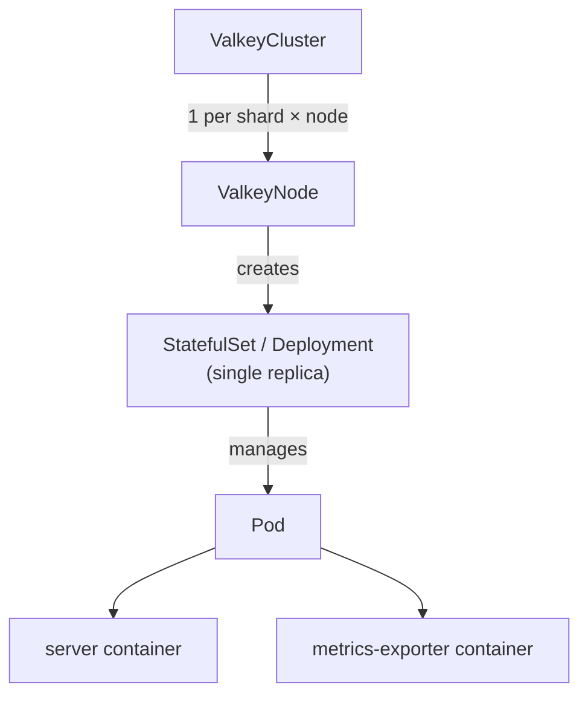

# ValkeyCluster

`ValkeyCluster` deploys Valkey in [Cluster mode](https://valkey.io/topics/cluster-tutorial/), handling:

- Topology scheduling
- Slot allocation
- Failovers
- Rolling updates
- ACLs

## Features

- [Config](#config)
- [Containers](#containers)
- [Default images](#default-images)
- [Metrics](#metrics)
- [Operator-managed Secrets](#operator-managed-secrets)
- [Persistence](#persistence)
- [Pod disruption budget](#pod-disruption-budget)
- [Pod metadata](#pod-metadata)
- [Private image registries](#private-image-registries)
- [Probes](#probes)
- [Scheduling](#scheduling)
- [Shards and replicas](#shards-and-replicas)
- [TLS](#tls)
- [Users](#users)
- [Workload type](#workload-type)

### Config

```yaml
config:
  io-threads: 4
  maxmemory-policy: noeviction
```

Use `config` to pass [Valkey configuration](https://valkey.io/topics/valkey.conf/) to all nodes in the cluster. Some directives require a newer Valkey release; see [Version-gated config](#version-gated-config)

Listed below are configurations can be applied live without rolling pods. We are adopting configs that can be applied live on a case-by-case basis. For any requests please [raise an issue](https://github.com/valkey-io/valkey-operator/issues/new).

```
maxclients
maxmemory         # There are no safeguards, ensure you do not exceed your container capacity
maxmemory-policy
```

Each node also writes the live values its server last accepted to its `live.conf`, so a pod that restarts boots with them. A pod that restarts before the new file reaches it boots with the previous value, and the operator sets the current value with CONFIG SET once the pod is ready. Changing any other key rolls the pods one at a time.

#### Failover tuning

`cluster-node-timeout` controls how long a node may be unreachable before the cluster marks it failed and starts a failover. The operator does not set it, so the Valkey default of 15 seconds applies. Set it in `spec.config` to tune failover for your network.

```yaml
config:
  cluster-node-timeout: "5000"
```

Lower values fail over faster but make the cluster more sensitive to network blips and to latency spikes on a busy primary. Values under 1 second are rarely a good idea outside a low-latency single-zone network. There is no validation on it by operator as it would require the type to be config aware instead of plain string. Changing it rolls the pods.

Operator versions before #434 have `cluster-node-timeout` hardcoded to 2000. Clusters created on an older operator roll once on upgrade and move to the Valkey default. Set the value explicitly in `spec.config` to keep the old behaviour.

`cluster-replica-no-failover` stops a replica from promoting itself. The operator reads this from the replica's `nofailover` flag in `CLUSTER NODES`, which also covers the `cluster-slave-no-failover` alias and `CONFIG SET`. Without persistence, the operator promotes such a replica with `CLUSTER FAILOVER TAKEOVER` once the primary's failure is confirmed (`fail`, or `fail?` from a majority of slot-owning primaries). Without failover quorum it takes over regardless of this setting. With persistence, the operator leaves recovery with quorum to Valkey; without quorum, takeover requires the `valkey.io/force-takeover` annotation described below.

#### Version-gated config

Some user-set `spec.config` directives are only valid on newer Valkey releases. When the operator cannot determine the image version (for example `latest` or a digest-pinned image), or the detected version does not support a directive, it drops that directive from the rendered `valkey.conf` and sets a `ConfigurationWarning` condition with reason `UnsupportedConfigDirective`.

Version gating applies only to keys the user sets in `spec.config`. Operator-managed directives rendered through the base config (for example `cluster-enabled`, TLS ports) are not filtered by `versionGatedConfig`; any future operator-owned directive that requires a newer Valkey minor must be gated explicitly where it is added.

If more than one configuration warning is active at the same time, the operator combines them into a single `ConfigurationWarning` condition with reason `MultipleConfigurationWarnings`.

The warning message names the directive, the minimum supported Valkey version, and the detected version or detection failure. The operator also emits a Kubernetes `Warning` event on the transition into this state. If you later switch to a supporting image, the condition clears on the next reconcile.

For example, `tls-auto-reload-interval` requires Valkey `9.1.0` or newer.

Apply the image change and wait for the roll to finish before adding a version-gated directive. Adding both in one spec change can write the new config to the shared ConfigMap before every node has the new image, and a node still on the old image can crash-loop if it restarts.

#### Reserved keys

The operator owns the keys below and rejects them in `config`. It sets each one itself, either in the base `valkey.conf` or as a `valkey-server` command-line flag. A user value would be overridden and the intent lost without a signal, so the CRD rejects it at admission. Keys are matched case-insensitively.

```
aclfile
cluster-allow-replica-migration
cluster-announce-hostname
cluster-announce-ip
cluster-config-file
cluster-enabled
cluster-preferred-endpoint-type
cluster-replica-validity-factor
dir
port
primaryauth
primaryuser
protected-mode
shutdown-on-sigterm
tls-auth-clients
tls-auth-clients-user
tls-ca-cert-file
tls-cert-file
tls-cluster
tls-key-file
tls-port
tls-replication
```

Cluster directives the operator does not set, such as `cluster-require-full-coverage`, `cluster-migration-barrier` and `cluster-node-timeout`, stay available.

Keys may contain only lowercase letters, digits, `.`, `_` and `-`. Valkey matches keys in any case, but the operator picks out live-settable keys such as `maxmemory` by exact name, so it would not apply `MAXMEMORY` live. Valkey also trims and unquotes each config line before reading its key, so a quoted or padded key such as `"port"` would otherwise bypass the list above. Module configs such as `search.<name>` stay valid.

#### Future plans

- Operator validates configs before they are applied to the server
  - https://github.com/valkey-io/valkey-operator/issues/141#issuecomment-4269559003

### Containers

```yaml
containers:
  - name: server
    env:
      - name: MY_VAR
        value: "example"
  - name: my-sidecar
    image: busybox:latest
    command: ["sh", "-c", "sleep infinity"]
```

`containers` patches the pod's container list using strategic merge patch. Containers named `server` or `metrics-exporter` are merged by name; anything else is appended as a sidecar. To tune or disable the `server` container's probes, use [`probes`](#probes).

The operator sets `securityContext.allowPrivilegeEscalation: false` on its
`server` and `metrics-exporter` containers when the field is unset. It keeps
any explicit value, and leaves the field unset on containers that run
privileged or add `SYS_ADMIN` (or `CAP_SYS_ADMIN`). Upgrading to a release
with this default rolls each pod once, unless an admission policy already
sets the field.

Sidecars added through `containers` are not defaulted. If an admission policy
(Kyverno, Gatekeeper, a MutatingAdmissionPolicy) sets this field on workload
templates, set it on every sidecar:

```yaml
containers:
  - name: log-shipper
    image: example/log-shipper:1.0
    securityContext:
      allowPrivilegeEscalation: false
```

Otherwise the admitted template never matches the one the operator renders,
and the operator fails over the shard primary on every reconcile while the
cluster still reports Ready. The same happens for any other field such a
policy adds to the template.

Each pod also runs an operator-managed [init container](architecture.md#init-container) named `server-init`. The API server rejects a `containers` entry with that name, and the init container cannot be patched through `containers`.

### Service account

```yaml
serviceAccountName: valkey-sa
```

`serviceAccountName` sets the Kubernetes ServiceAccount used by each ValkeyNode
pod. If unset, the pod uses the namespace's default ServiceAccount.

The referenced ServiceAccount **must already exist in the same namespace** as the ValkeyCluster. The operator assigns the name to each pod template; it does not create the ServiceAccount or configure its RBAC. If the ServiceAccount does not exist, pod admission rejects each pod and the cluster cannot become ready. The operator reports a `ConfigurationWarning` with reason `ServiceAccountNotFound`; if an API error prevents the existence check, it reports `ServiceAccountLookupFailed`. The check is advisory, and Kubernetes admission remains authoritative. Changing this field updates every ValkeyNode pod template and rolls all pods.

### Default images

The operator requires the `--default-valkey-image` and `--default-exporter-image`
flags. A ValkeyCluster or ValkeyNode uses these images when `spec.image` or
`spec.exporter.image` is empty.

- Changing `--default-valkey-image` rolls the pods of every ValkeyCluster that
  omits `spec.image`.
- Changing `--default-exporter-image` rolls pods with an enabled exporter whose
  ValkeyCluster omits `spec.exporter.image`.

When upgrading a deployment that supplies its own manager arguments, add both
flags. To keep the previous image defaults, use
`--default-valkey-image=valkey/valkey:9.0.0` and
`--default-exporter-image=oliver006/redis_exporter:v1.88.0`.
The Kustomize deployment and `make run` already pass these values. When using
a Helm chart that does not supply these flags, add them to `manager.args`.

### Metrics

```yaml
exporter:
  enabled: true   # default
  image: oliver006/redis_exporter:v1.88.0
  args: # optional command-line flags for exporter
    - -ping-on-connect
  resources:
    requests:
      memory: "64Mi"
      cpu: "50m"
```

NOTE: `oliver006/redis_exporter` command-line arguments have higher priority than the environment variables passed by default, so `exporter.args` can override them when needed.

Each pod runs a `metrics-exporter` sidecar by default, exposing Prometheus metrics on port `9121`. To disable it:

```yaml
exporter:
  enabled: false
```

### Persistence

```yaml
persistence:
  size: 10Gi
  storageClassName: gp3
  reclaimPolicy: Retain
```

When `persistence` is set, the operator manages a PVC for each ValkeyNode. With the [save config option](https://valkey.io/topics/persistence/), memory state survives pod rolls and [partial resyncs](https://valkey.io/topics/replication/) are possible.

`Retain` keeps the PVC when a ValkeyNode is deleted; `Delete` removes it.

If a primary fails and the cluster has no failover quorum (for example a single shard), Valkey cannot promote its replica. With persistence, the operator does not take over automatically: a timer cannot distinguish a dead primary from a partitioned or slow-restarting one, and takeover may discard writes that exist only on the primary's volume. The cluster is marked `Degraded=True` with reason `AwaitingManualTakeover`. Its message and a Warning event identify the shard, failed primary, eligible replica, and command to authorize takeover.

Alert on `Degraded=True` with reason `AwaitingManualTakeover`. Kubernetes events expire, so a Warning event may disappear while recovery is still pending.

Before authorizing recovery, inspect the recovery condition, node roles, pods, and events:

```sh
kubectl get valkeycluster <name> -n <namespace> -o yaml
kubectl get valkeynodes -n <namespace> -o wide
kubectl get pods,pvc -n <namespace>
kubectl get events -n <namespace> --sort-by=.metadata.creationTimestamp
```

Use the `AwaitingManualTakeover` message to identify the failed primary and candidate replica. The message includes the replica's replication offset, whether a full sync is in progress, and whether its link to the primary is up or down. Missing values are reported as unknown. An offset of zero can describe an empty dataset; an unknown offset or a replica still syncing needs investigation. These values do not prove that the replica has every acknowledged write. Approval names the failed primary. The candidate can change as replicas become available or their offsets advance, so inspect every replica you would accept as the new primary. Check the candidate's `INFO replication` for the link-down duration, along with its persistence status and logs. Check the primary pod's phase and readiness before approving. If the replica points to a different node at the old primary's address, a full sync from that node can replace the replica's data. Check what the replica still holds before promoting it.

Check whether the primary's pod or storage can return, and whether the problem is a network partition. An unschedulable pod or an unreachable server does not prove its durable data is lost. Compare the available copies before choosing recovery: with RDB snapshots alone, a restarted primary can be older than its replica, and a full resync from that primary can discard the replica's newer writes. Check `appendonly`, `appendfsync`, and `save` in the effective configuration, and inspect persistence status and logs. AOF can narrow the loss window, but its presence alone is not proof that all writes reached disk. See [Failure handling](#failure-handling).

Before approving takeover, stop the old primary or isolate it from clients that can write to it. Do not assume that deleting a pod on a partitioned host stopped its process; confirm it has stopped, or block client access on that side of the partition. Writes it accepts after the replica is promoted can be discarded when it rejoins. The operator does not fence the old process for you.

Manual takeover provides a recovery path when too few slot-owning primaries remain available for Valkey's normal failover election. This includes a single-shard cluster whose primary is down, or a three-primary cluster with two primaries down. If multiple primaries are lost, you may need to approve more than one takeover until a majority of slot-owning primaries is available to vote.

Each approval authorizes one operator-issued TAKEOVER. This takeover bypasses Valkey's normal failover election. Promoting that replica can give the cluster failover quorum again. Valkey can then promote replicas of the other orphaned primaries through its own election, without further approval. Before approving any takeover, check every orphaned shard in the condition and confirm you would accept its replica as the new primary. If you want to wait for one of those primaries to return, approve nothing until it does. See Valkey’s [CLUSTER FAILOVER documentation](https://valkey.io/commands/cluster-failover/) and [replica election and promotion specification](https://valkey.io/topics/cluster-spec/#replica-election-and-promotion).

To accept the possible data loss, annotate the ValkeyCluster with the failed primary's node ID:

```sh
kubectl get valkeycluster <name> -n <namespace> -o yaml
# Read metadata.resourceVersion and the current approval list from this output.
kubectl annotate valkeycluster <name> -n <namespace> valkey.io/force-takeover=<updated-primary-id-list> --resource-version=<resourceVersion> --overwrite
```

The annotation applies only to an eligible orphan whose primary is unreachable in the current scrape. The operator removes that primary's ID before sending TAKEOVER, preserving any other IDs in the annotation. Each approval authorizes one attempt. If the command fails or the operator stops after consuming the approval, check the live topology before approving another attempt. A missing response does not establish that promotion failed.

To approve more than one primary, use a comma-separated list. Include any existing approvals you want to keep. To cancel one pending approval, read the current list and resourceVersion together, then use the version-checked command above with only that ID removed. To cancel the last approval, use `valkey.io/force-takeover-` with the same resourceVersion check. If the write conflicts, read the object again and recompute the list. A stale edit or an overwrite without a version check can restore an approval the operator already consumed. Consuming an approval commits the operator to the attempt, so removing the annotation after that point cannot cancel the command.

While an orphan remains unresolved, the operator pauses later topology repairs, including repairs in other shards. It can still repair stale peer addresses while waiting. If the primary returns, `AwaitingManualTakeover` clears. How much data it recovers depends on its persistence configuration and the files it can load.

After takeover, check the node roles and application data, then inspect any remaining conditions. The cluster may still need missing pods or replicas restored before it becomes `Ready`.

#### Constraints

- Only supported with `workloadType: StatefulSet`
- Cannot be added or removed after creation
- Size can only grow
- `storageClassName` is immutable

#### Future plans

- Live volume expansion
- Automated volume expansion

### Failure handling

Without `persistence`, `/data` is an `emptyDir`. It survives a server container restart within the same pod. If Valkey's `save` rules have written an RDB snapshot, Valkey can reload it on restart when the data directory is kept. Writes after the snapshot can be lost. Replacing the pod removes its `emptyDir`.

When a primary crashes, the restarted container waits until each of its reachable replicas has a slot assignment as a primary or follows another node. It waits up to six `cluster-node-timeout` intervals, capped at five minutes. After the hand-off, it clears `/data`, including any local snapshot, and joins as a replica of the promoted primary. A replica with `cluster-replica-no-failover` also counts because the operator can promote it with `CLUSTER FAILOVER TAKEOVER`.

If there are no reachable replicas or the wait expires, the server keeps its node ID, slots, and local files. In this case, an RDB snapshot can restore data through the last save.

With `persistence`, a primary whose server crashes restarts with its node ID and reloads its last snapshot. Valkey does not enable the append-only file by default, so with snapshots alone the writes since the last save are lost, and its replica, which may hold them, full-syncs to the older data. Set `appendonly: "yes"` in `config` to keep that window small.

### Pod disruption budget

```yaml
podDisruptionBudget:
  mode: Cluster  # default
```

The operator creates a `PodDisruptionBudget` with `maxUnavailable: 1` selecting all pods in the cluster. Set `mode: Disabled` when the PDB is managed externally or is not required. Omitting `podDisruptionBudget` entirely is equivalent to `mode: Cluster`.

| Mode | Behaviour |
|---|---|
| `Cluster` | Operator creates and owns a single cluster-wide PDB |
| `Disabled` | Operator deletes the PDB if it exists and does not recreate it |

A PDB counts a pod as available only when the pod is Ready. Each cluster pod has the readiness gate `valkey.io/initial-sync-complete`, which the operator sets once the pod holds its shard's data: it owns slots, or it is a replica that finished its full sync from its primary. The primary of a shard that is not in the cluster yet is marked straight away, since it has nothing to copy. Until then the pod is not Ready, so a node drain cannot evict a primary while its replacement replica is still copying the data. A dropped replication link does not clear the gate; a new full sync, a dataset load, or a restart of the server container does, and the pod has to show its data again. The operator's own roll waits for the containers to be ready, not for the gate.

If the operator is down, new pods stay not Ready and drains wait until it is back; running pods keep their gate. The operator needs `get` and `patch` on `pods/status` to set it. A refused write holds the roll and is reported as `InitialSyncGateFailed`; see [status conditions](status-conditions.md#ready).

### Pod metadata

```yaml
podMetadata:
  labels:
    team: data
  annotations:
    example.com/owner: data-platform
```

`podMetadata` adds labels and annotations to every Valkey pod, for example to select the pods from a `PodMonitor`, a `NetworkPolicy`, or a Service. They are set on each ValkeyNode pod template but kept out of the workload selector, so they can be changed at any time. Changing them rolls all pods.

Keys the operator owns are rejected: any label or annotation key under `valkey.io/`, and the `app.kubernetes.io/` `name`, `instance`, `component`, `part-of` and `managed-by` labels. Other `app.kubernetes.io/` keys, such as `app.kubernetes.io/version`, are allowed.

Keys and label values are validated when the ValkeyCluster is applied, with the same rules Kubernetes applies to pod metadata, so a value Kubernetes would reject on the pod (for example a label value with a space) is rejected up front. Annotation values have no format rule, but annotation keys and values together are limited to 256 KiB. Each map holds at most 1024 entries.

The ValkeyCluster's own `metadata.labels` are not copied to pods; use `podMetadata` instead.

### Graceful shutdown

On `SIGTERM` (a node drain, eviction, or preemption), a cluster primary fails its slots over to a replica before exiting, so descheduling a primary the operator did not initiate does not leave the shard without a writer. This is enabled by default through the `shutdown-on-sigterm failover` server config and requires Valkey 9.0+.

The handoff runs inside the pod's termination grace period. With defaults there is comfortable margin: the Kubernetes default `terminationGracePeriodSeconds` is 30s and the Valkey default `cluster-manual-failover-timeout` is 5s, so the failover completes well before `SIGKILL`. If you raise `cluster-manual-failover-timeout`, the operator raises the derived `terminationGracePeriodSeconds` to match; see [Termination grace period](#termination-grace-period).

### Termination grace period

```yaml
terminationGracePeriodSeconds: 60
```

`terminationGracePeriodSeconds` sets the pod termination grace period for the Valkey nodes. On `SIGTERM` a primary gracefully fails its slots over to a replica, and that handover has to finish before Kubernetes sends `SIGKILL`, so the grace period must be at least `cluster-manual-failover-timeout` plus some headroom.

When omitted, the operator picks a safe value: the larger of the Kubernetes default (30s) and `cluster-manual-failover-timeout` (default 5s) plus a 10s buffer. With defaults that stays at 30s. Raising `cluster-manual-failover-timeout` pulls the derived grace period up with it.

An explicit value is honoured as-is, even if it is below the recommended minimum. In that case the operator sets a `ConfigurationWarning` condition (reason `GracePeriodTooShort`) on the `ValkeyCluster` and emits an event when the cluster first enters that state, rather than silently overriding the value. The value must be a positive integer; the CRD rejects zero or negative values.

### Failback

```yaml
failover:
  failback:
    mode: Enabled          # Enabled (default) or Disabled
    quietPeriodSeconds: 300
```

Each shard has an intended primary, its `node-index=0` member, which is where `scheduling.node.spread.primaries`, `scheduling.zone.spread.primaries` and `scheduling.zone.pinning` place it. A failover moves the primary role to a replica. Failback moves it back with a graceful `CLUSTER FAILOVER` sent to the `node-index=0` member, the same handoff the operator makes before rolling a primary. It never uses `FORCE` or `TAKEOVER`.

A shard fails back when its `node-index=0` member is a Ready replica in sync with the primary. When does it happen?

- During a roll, the operator moves the primary away itself before rolling the `node-index=0` pod. It fails the shard back as soon as the rolled pod has synced, without a quiet period. The roll does not wait for that sync and goes on to the next shard in the meantime.
- After any other failover, for example when the `node-index=0` pod was deleted or its node failed, the operator waits until the member has stayed in sync for `quietPeriodSeconds` and the whole cluster is healthy. One shard fails back per reconcile. A member that restarts or loses its replication link starts the quiet period again, so a pod that keeps restarting does not take the primary role back each time it comes up.

If a failback attempt fails, the shard waits a full quiet period, counted from the failure, before the next one. `status.failback` lists the shards whose primary is away from `node-index=0`, and the `PrimaryDisplaced` condition says what failback is waiting for. See [status conditions](status-conditions.md#primarydisplaced).

`mode: Disabled` leaves the primary wherever the last failover put it. `quietPeriodSeconds` defaults to 300 and must be at least 10.

### Private image registries

```yaml
image: registry.example.com/valkey/valkey:9.0.0
imagePullSecrets:
  - name: registrycredential
```

`imagePullSecrets` is a list of `Secret` references (in the cluster's namespace) used to pull images from private registries. It is applied at the pod level, so a single list covers every image in the pod - the Valkey server, the metrics exporter sidecar, and any additional containers. It is optional and has no default; omit it when the nodes already authenticate to the registry.

### Probes

```yaml
probes:
  startup:
    failureThreshold: 120
  liveness:
    mode: Disabled  # BuiltIn (default) | Disabled
  readiness:
    periodSeconds: 10
    timeoutSeconds: 3
```

`probes` tunes the startup, liveness and readiness probes of the `server` container. Each field you set replaces one default and the others keep theirs, so setting only `failureThreshold` keeps the period, the timeout and the check. The one default that follows another field is the startup `failureThreshold`, which keeps the startup window when you change `periodSeconds`; see [Startup window](#startup-window).

| Probe | Check | `initialDelaySeconds` | `periodSeconds` | `timeoutSeconds` | `successThreshold` | `failureThreshold` |
|---|---|---|---|---|---|---|
| `startup` | `liveness-check.sh` | 5 | 5 | 4 | 1, fixed | enough checks for 100 seconds, or 400 without `persistence`, and at least 3: 20 or 80 at the default period |
| `liveness` | `liveness-check.sh` | not settable | 5 | 4 | 1, fixed | 5 |
| `readiness` | `readiness-check.sh` | not settable | 5 | 1 | 1 | 5 |

`timeoutSeconds` is how long Valkey has to answer, at most 3600. The operator passes it, or its default, to the check script and sets the probe's own timeout one second higher, so that the script normally gives up first; the defaults above appear in the pod as 5, 5 and 2. The script counts 0.1-second polls, which run late with a long timeout or a CPU-throttled container, and a check that runs past the extra second fails on the probe's timeout instead, which counts as a failed check all the same. Liveness and readiness have no `initialDelaySeconds` because they start only after the startup probe passes, and Kubernetes requires a `successThreshold` of 1 for startup and liveness.

Both checks run `valkey-cli` against the local server. The liveness check passes on `PONG`, `LOADING` and `MASTERDOWN`, so a slow load of the dataset does not fail it, but a blocked event loop does: a slow command, a fork, or a CPU-throttled container where `valkey-cli` itself runs slowly. The readiness check passes only on `PONG`. A pod is Ready only once the [initial sync gate](#pod-disruption-budget) is set as well. After a restart of the server container the pod keeps its gate until the operator sees the new container and clears it, so a startup probe that passes sooner, with a shorter `initialDelaySeconds` or `periodSeconds`, leaves the operator less time to clear the gate before the pod reads Ready.

#### Disabling liveness

`liveness.mode: Disabled` removes the liveness probe. Only liveness can be disabled: the operator moves a roll on only once the containers are ready, so startup and readiness stay on.

A failed liveness probe makes the kubelet restart the server container. The restart is not an eviction, so neither the PodDisruptionBudget nor the readiness gate holds it back, and from inside the pod a busy node looks the same as a hung one. Some of the operator's own work loads a node: a replacement replica's full sync forks the primary, and a rebalance or scale-in moves up to 400 slots in each `CLUSTER MIGRATESLOTS` batch. A CPU-throttled container makes both slower. The restart is handled like a crash of the server; see [Failure handling](#failure-handling) for what a primary keeps without `persistence`.

For a node that is busy rather than hung, raise `liveness.failureThreshold` (or `periodSeconds`) first: the check already passes while the server loads its dataset, and a real hang still gets a restart. Disable liveness only when you would rather the cluster fail a node over than the kubelet restart it. A hung node then stays up but not Ready, and nothing restarts it until you delete the pod. The cluster fails it over if it is a primary, but the node walk waits at that node, so a roll and the steps after it do not run, and a later template change, turning liveness back on included, does not replace the pod, because the operator does not replace a pod whose server is running but does not answer. While it is not Ready it also uses the cluster PodDisruptionBudget's one unavailable pod, so node drains cannot evict any other pod of the cluster. Timing fields cannot be set together with `mode: Disabled`.

#### Startup window

Without `persistence`, a primary whose server restarts waits up to six `cluster-node-timeout`s, at most 300 seconds, for a replica to take over before the server starts again (see [Failure handling](#failure-handling)), and its startup probe fails during the wait. A startup probe that gives up sooner restarts the container into the same wait, so a node whose replica never takes over would not start.

The startup probe checks first after `initialDelaySeconds`, then every `periodSeconds`, so it gives up after `initialDelaySeconds` + (`failureThreshold` − 1) × `periodSeconds`. An unset `failureThreshold` is the smallest that gives up no sooner than 400 seconds without `persistence`, the longest wait plus the default 100 seconds, and 100 seconds with it, and at least 3, so a long `initialDelaySeconds` still leaves retries: 80 or 20 checks at the default delay and period of 5 seconds, 41 or 11 at a period of 10 seconds. A `failureThreshold` you set is used as is. When it gives up in less than 400 seconds on a cluster without `persistence` that has replicas, the operator sets a `ConfigurationWarning` condition with reason `StartupProbeTooShort`, whose message names the `failureThreshold` that covers 400 seconds, and emits an event when the cluster first enters that state, as it does for a short [termination grace period](#termination-grace-period). Without replicas a restarted primary has no one to wait for, so there is no warning. The warning uses the longest wait whatever `cluster-node-timeout` is, so with a shorter timeout a shorter window can be enough, and it reads `probes` only, not a startup probe patched in through [`containers`](#containers).

#### Changing probes

Changing `probes` changes the pod template, so the pods roll as for any other template change: one at a time, replicas before their primary, with a failover before each primary. Upgrading to a release whose probe commands always pass the check timeout rolls each pod once, whether or not the cluster sets `probes`.

[`containers`](#containers) patches are applied after `probes`, so a probe field set in both takes the `containers` value, and `containers` remains the way to use your own check. A `timeoutSeconds` patch changes only the probe's own timeout: the check script keeps the `probes` value, or its default, unless the patch replaces the command too. To replace the liveness check, set `liveness.mode: Disabled` and give the `server` container a complete `livenessProbe`, handler included, in `containers`. Take that patch out before you set the mode back to `BuiltIn`: an `httpGet`, `tcpSocket` or `grpc` handler in it would be merged next to the operator's `exec` check, giving the probe two handlers. With liveness disabled there is no operator probe for a patch to merge into, so a `livenessProbe` patch that sets only timings leaves a probe without a handler.

Kubernetes rejects a probe with no handler or more than one, so before it writes a node's StatefulSet or Deployment the operator checks every probe of the merged containers, sidecars included. If one fails, the operator leaves the workload as it is, so the node's pod keeps running on its current template, and the ValkeyNode reports `Ready=False` with reason `InvalidPodTemplate` and a message naming the container and the probe. The roll waits at that node, and a node created with the patch gets no pod, until the patch is fixed. The API server alone would not always keep the pod: it refuses such a Deployment, and from Kubernetes 1.34 such a StatefulSet, but before 1.34 it accepts the StatefulSet, and the roll deletes the pod without being able to create its replacement.

### Shards and replicas

```yaml
shards: 3
replicasPerShard: 1  # 3 primaries + 3 replicas
```

`shards` sets the number of shards, and `replicasPerShard` sets the number of replicas in each shard in addition to its primary. A shard follows the [Valkey definition](https://valkey.io/commands/cluster-shards/): one primary and its replicas, serving the same slots. `replicasPerShard` defaults to 0.

#### Migrating from `spec.replicas`

`replicas` is the deprecated name of `replicasPerShard`. A cluster with a non-zero `replicas` gets a `ConfigurationWarning` condition with reason `DeprecatedField`. `replicas: 0` does not warn. The API server rejects a new or changed `replicas`, and it rejects a spec that sets both fields. Removing `replicas` is accepted only when the same update sets `replicasPerShard` to that stored count. An absent `replicasPerShard` counts as 0, so removing a stored `replicas: 0` needs no replacement field.

1. Check that the installed CRD has the new field: `kubectl explain valkeyclusters.spec.replicasPerShard` must print it. Helm does not upgrade CRDs from a chart's `crds` directory. On an old CRD the API server drops `replicasPerShard` from the patch in step 3, which then leaves the cluster with 0 replicas.
2. Wait until the new operator release runs and the old operator pod is gone.
3. Read the current `spec.replicas` and replace it with `replicasPerShard` in a single update. The patch keeps that count:

   ```sh
   n=$(kubectl get valkeycluster <name> -o jsonpath='{.spec.replicas}') && \
   kubectl patch valkeycluster <name> --type=merge -p "{\"spec\":{\"replicas\":null,\"replicasPerShard\":${n:?spec.replicas is not set}}}"
   ```

To change the replica count of a cluster that still stores `replicas`, migrate first, then set the new count on `replicasPerShard` in a second update. A single update that removes `replicas` and sets a different `replicasPerShard` is rejected.

Applying an edited manifest works only if the apply removes `replicas`. Two cases keep it, and the API server rejects the update: client side `kubectl apply` on a cluster that was not created with `kubectl apply`, and server side apply when another field manager owns `spec.replicas`, for example after a `kubectl patch`. The merge patch works in both cases.

A Go program built against an older `api/v1alpha1` drops `replicasPerShard` when it reads and then updates a ValkeyCluster, because its type does not have the field. Update such programs before you migrate.

The rename does not create, delete, or restart any pod. An operator release that does not know `replicasPerShard` reads 0 replicas from a migrated cluster and deletes every ValkeyNode with node index 1 or higher.

### Scheduling

```yaml
scheduling:
  tolerations:
    - key: "dedicated"
      operator: "Equal"
      value: "valkey"
      effect: "NoSchedule"
  nodeSelector:
    kubernetes.io/arch: amd64
  affinity:
    podAntiAffinity:
      requiredDuringSchedulingIgnoredDuringExecution:
        - labelSelector:
            matchLabels:
              app.kubernetes.io/name: valkey
          topologyKey: kubernetes.io/hostname
  priorityClassName: high-priority
```

`scheduling.tolerations`, `scheduling.nodeSelector`, `scheduling.affinity`, and `scheduling.priorityClassName` are passed through to every pod in the cluster (`scheduling.nodeSelector` also carries the curated zone entry when [`zone.pinning`](#zone-axis-pinning) is set, see below). `priorityClassName` must reference an existing [PriorityClass](https://kubernetes.io/docs/concepts/scheduling-eviction/pod-priority-preemption/) and protects the Valkey pods from eviction under resource pressure.

For same-shard spread on a custom topology key, use `podAntiAffinity` with `matchLabelKeys`. The operator copies `scheduling.affinity` onto every pod; `matchLabelKeys` then pulls `valkey.io/shard-index` from that pod, so the term only counts other members of the same shard. `matchLabelKeys` needs the `MatchLabelKeysInPodAffinity` feature gate, which is on by default from Kubernetes 1.31, the operator's minimum. If the gate is off, the apiserver drops the field and the term applies to the whole cluster: one Valkey pod per rack, with the rest `Pending` and the cluster `Degraded` with reason `PodUnschedulable`.

```yaml
scheduling:
  affinity:
    podAntiAffinity:
      requiredDuringSchedulingIgnoredDuringExecution:
        - topologyKey: topology.example.com/rack
          labelSelector:
            matchLabels:
              valkey.io/cluster: my-cluster
          matchLabelKeys:
            - valkey.io/shard-index
```

A required term needs at least `1 + replicasPerShard` racks, or the extra members of each shard stay `Pending`. With fewer racks, use the preferred form, which keeps a shard's members apart where it can:

```yaml
scheduling:
  affinity:
    podAntiAffinity:
      preferredDuringSchedulingIgnoredDuringExecution:
        - weight: 100
          podAffinityTerm:
            topologyKey: topology.example.com/rack
            labelSelector:
              matchLabels:
                valkey.io/cluster: my-cluster
            matchLabelKeys:
              - valkey.io/shard-index
```

With the preferred form on the same setup (3 shards × 3 members on 2 racks), all 9 pods get scheduled and every shard has members on both racks.

#### Topology spread constraints

`topologySpreadConstraints` is a raw escape hatch: whatever you set is rendered **verbatim** onto every Valkey pod in the cluster. The operator does not scope, augment, or shard-index it, and adds no constraints of its own by default.

> **You must supply your own `labelSelector`.** A topology spread constraint with no `labelSelector` matches *nothing* — Kubernetes counts zero pods and the constraint enforces nothing (a silent no-op).
>
> Set a `labelSelector` that selects the pods you want counted; `valkey.io/cluster: my-cluster` selects every pod in the cluster.

For the common intents such as keep a shard's pods on different nodes, spread each shard's primary across nodes, or spread all pods across nodes — prefer [`scheduling.node.spread`](#node-axis-spread) below, and for the zone equivalents prefer [`scheduling.zone.spread`](#zone-axis-spread) or, to pin each pod to a specific zone rather than balance it, [`scheduling.zone.pinning`](#zone-axis-pinning). These fill in the correct label selectors for you and guarantee the constraints they emit don't collide. For same-shard separation on a topology key other than hostname or zone, use the `podAntiAffinity` + `matchLabelKeys` recipe above. Reach for `topologySpreadConstraints` only when you need something neither axis expresses, such as cluster-wide balancing on a custom topology key.

> **Do not overlap a hostname or zone constraint with `node.spread`/`zone.spread`.**
>
> A passthrough constraint on `topologyKey: kubernetes.io/hostname` collides with an enabled `node.spread.primaries` or `node.spread.pods` that renders the same `whenUnsatisfiable` (`Required` → `DoNotSchedule`, `Preferred` → `ScheduleAnyway`), because the pod would carry two constraints sharing that `{topologyKey, whenUnsatisfiable}` pair — which Kubernetes forbids. The same is true on `topologyKey: topology.kubernetes.io/zone`: a passthrough constraint there collides with an enabled `zone.spread.shard`, `zone.spread.primaries`, or `zone.spread.pods` of matching `whenUnsatisfiable`.
>
> The operator rejects both combinations at admission, so keep hostname spreading in `node.spread`, keep zone spreading in `zone.spread`, and reserve `topologySpreadConstraints` for other topology keys. A passthrough constraint whose `whenUnsatisfiable` differs from what the enabled dimensions render is still allowed.

Each constraint must include:

| Field | Meaning |
|---|---|
| `maxSkew` | Maximum allowed difference in matching pod count between topology domains. `1` means Kubernetes keeps the matching pods as evenly spread as possible. |
| `topologyKey` | Node label used as the spread domain. Use `kubernetes.io/hostname` for worker-node spreading, or labels such as `topology.kubernetes.io/zone` for zone spreading. |
| `labelSelector` | Which pods to count. Required for the constraint to do anything (see note above). |
| `whenUnsatisfiable` | What Kubernetes should do when the constraint cannot be satisfied. |

`whenUnsatisfiable` supports:

| Value | Behaviour | Impact |
|---|---|---|
| `DoNotSchedule` | Hard rule. Kubernetes will not schedule the pod if placement would violate the constraint. | Stronger placement guarantees, but pods may remain `Pending` when there are not enough eligible nodes or topology domains. The operator marks the cluster `Degraded` with reason `PodUnschedulable`. |
| `ScheduleAnyway` | Soft rule. Kubernetes prefers satisfying the constraint, but can still schedule the pod if it cannot. | Better scheduling availability in constrained clusters, but matching pods may still share a topology domain. |

Example — spread pods across rack failure domains, a topology that neither `node.spread` nor `zone.spread` expresses (your nodes must carry the label):

```yaml
scheduling:
  topologySpreadConstraints:
    - maxSkew: 1
      topologyKey: topology.example.com/rack   # a custom node label; neither node.spread nor zone.spread covers it
      whenUnsatisfiable: ScheduleAnyway
      labelSelector:
        matchLabels:
          valkey.io/cluster: my-cluster
```

Switch `whenUnsatisfiable` to `DoNotSchedule` to make it a hard rule; pods that cannot be placed within `maxSkew` then stay `Pending` rather than colocating.

#### Node axis spread

```yaml
scheduling:
  node:
    spread:
      shard:
        mode: Preferred
      primaries:
        mode: Disabled
      pods:
        mode: Disabled
```

`scheduling.node.spread` groups three independent spread dimensions, each keyed on `kubernetes.io/hostname`, so you get shard- and primary-aware placement without hand-writing label selectors:

| Field | Rendered as | Effect |
|---|---|---|
| `shard` | Pod anti-affinity | Keeps pods belonging to the same shard, for example a primary and its replica, off the same node. |
| `primaries` | Topology spread constraint on each shard's node-index-0 pod | Spreads the pod that holds each shard's primary (at creation) across nodes. |
| `pods` | Topology spread constraint on every cluster pod | Spreads all of the cluster's pods across nodes, regardless of shard. |

Each field takes a `mode`:

| Mode | Behaviour |
|---|---|
| `Disabled` | Emits nothing for that dimension. This is the default for all three fields. |
| `Preferred` | Soft rule: a `preferredDuringSchedulingIgnoredDuringExecution` anti-affinity term (`shard`), or a topology spread constraint with `whenUnsatisfiable: ScheduleAnyway` (`primaries`, `pods`). Kubernetes biases placement but never leaves a pod `Pending` because of it. |
| `Required` | Hard rule: a `requiredDuringSchedulingIgnoredDuringExecution` anti-affinity term (`shard`), or a topology spread constraint with `whenUnsatisfiable: DoNotSchedule` (`primaries`, `pods`). A pod that cannot satisfy the rule stays `Pending`. |

> **`primaries` targets the primary at creation, not the live primary.**
>
> It keys its topology spread constraint on each shard's `node-index=0` pod. A topology spread constraint is only evaluated when a pod is scheduled and never re-evaluated on a running pod, so `primaries` deliberately targets this stable identity rather than a live primary-role label. After a failover the primary is away from the `node-index=0` pod until [failback](#failback) returns it, which is immediate after a roll and waits for the quiet period after any other failover. With failback disabled, the primary stays wherever the last failover put it, and `primaries: Required` only spreads the pods that start as primaries.

`shard`, `primaries`, and `pods` all default to `Disabled` when `node.spread`, `scheduling.node`, or `scheduling` itself is omitted. This is opt-in and matches today's behaviour, so an existing cluster that sets no scheduling constraints at all renders byte-identical pod specs after an operator upgrade — no fleet-wide rolling restart. A cluster that already sets `topologySpreadConstraints` is not covered by that guarantee: those constraints lose the old implicit shard-scoping under verbatim rendering (see above), so it gets a one-time re-render on upgrade even without touching `node.spread`. The trade-off is that nothing stops a shard's primary and replica from landing on the same node until you opt in. For production availability, set `shard` to at least `Preferred` so that losing a single node cannot take out every copy of a shard's data.

`primaries` and `pods` both render as topology spread constraints on `kubernetes.io/hostname`. Setting them to the same mode would produce two constraints of identical strength competing over the same domain, so the operator rejects the combination at admission:

- `primaries: Required` together with `pods: Required` is rejected.
- `primaries: Preferred` together with `pods: Preferred` is rejected.

Mixing strengths (one `Preferred`, the other `Required`), or leaving one of them `Disabled`, is always allowed. `shard` is exempt from this rule since it renders as pod anti-affinity rather than a topology spread constraint, so it can be combined freely with any `primaries`/`pods` setting.

#### Zone axis spread

```yaml
scheduling:
  zone:
    spread:
      shard:
        mode: Preferred
```

`scheduling.zone.spread` mirrors `node.spread`'s three dimensions, but keyed on `topology.kubernetes.io/zone` instead of `kubernetes.io/hostname`:

| Field | Rendered as | Effect |
|---|---|---|
| `shard` | Topology spread constraint scoped to each shard's pods | Balances a shard's pods across zones. |
| `primaries` | Topology spread constraint on each shard's node-index-0 pod | Balances the pod that holds each shard's primary (at creation) across zones. |
| `pods` | Topology spread constraint on every cluster pod | Balances all of the cluster's pods across zones, regardless of shard. |

On the node axis, `shard` renders as pod anti-affinity: a hard `Required` setting can leave pods `Pending` rather than colocate them. On the zone axis, `shard` is a topology spread constraint instead, because forbidding same-zone placement outright would make a shard unschedulable in any cluster with fewer zones than shard members. So zone `shard` balances rather than forbids: it keeps a shard's replicas as evenly spread across zones as `maxSkew` allows, but two members of the same shard may still land in the same zone once the shard is larger than the number of available zones.

Each field takes the same `Disabled` / `Preferred` / `Required` modes as `node.spread`, with the same soft/hard semantics. All three default to `Disabled` when `zone.spread`, `scheduling.zone`, or `scheduling` itself is omitted, so the zone axis is opt-in and emits nothing until you enable it.

`shard`, `primaries`, and `pods` all render as topology spread constraints on `topology.kubernetes.io/zone`. On the node axis `shard` is exempt from the slot limit because it renders as anti-affinity, but on the zone axis all three dimensions compete for the same two slots (`DoNotSchedule` and `ScheduleAnyway`) per zone. The operator rejects any combination where more than one of the three is `Required`, or more than one is `Preferred`, at admission; leaving at least two of the three `Disabled` (as in the sample above, which enables only `shard`) is the common case.

The zone axis is independent of the node axis. `node.spread` and `zone.spread` key on different topology keys, so a cluster can enable both at once, for example `node.spread.shard: Required` alongside `zone.spread.shard: Preferred`, to keep shard members off the same node while also biasing them across zones.

> **Zone `primaries` is placement-time, not maintained**
>
> As on the node axis, `zone.spread.primaries` constrains each shard's `node-index=0` pod — the primary *at creation*, not the live primary. The constraint is evaluated only when a pod is scheduled, so after a failover the promoted primary can sit at `node-index>0` in whatever zone it landed; the spread then reflects where primaries were *placed*, not where they currently are, until [failback](#failback) returns them to `node-index=0`. With failback disabled, read it as "spread the pods that start as primaries" and not a live guarantee.

> **Cross-zone spreading has a cost**
>
> Placing a shard's primary and replicas in different availability zones means every replicated write crosses a zone boundary; adding write latency and inter-zone data-transfer cost (if applicable). It is usually the right trade for availability (a single zone outage cannot take out a whole shard), but it is not free, consider the trade-off before applying.

#### Zone axis pinning

```yaml
scheduling:
  zone:
    pinning:
      zones:
        - eu-west-1a
        - eu-west-1b
        - eu-west-1c
```

Where `zone.spread` asks the scheduler to balance pods across zones, `zone.pinning` decides each pod's zone outright. A pod's zone is `zones[(shardIndex + nodeIndex) % len(zones)]`, rendered as a `topology.kubernetes.io/zone` entry in the pod's `nodeSelector`. For 3 shards with 1 replica each and the three zones above:

| ValkeyNode | Shard | Node index | Role at creation | Zone |
|---|---|---|---|---|
| `cluster-0-0` | 0 | 0 | primary | `eu-west-1a` |
| `cluster-0-1` | 0 | 1 | replica | `eu-west-1b` |
| `cluster-1-0` | 1 | 0 | primary | `eu-west-1b` |
| `cluster-1-1` | 1 | 1 | replica | `eu-west-1c` |
| `cluster-2-0` | 2 | 0 | primary | `eu-west-1c` |
| `cluster-2-1` | 2 | 1 | replica | `eu-west-1a` |

While there are at least as many zones as shards, primaries land in distinct zones as a side effect of the modulo rather than as an enforced property; once shards exceed the zone count, primaries repeat zones too (with 6 shards over 3 zones, shards 0 and 3 share a zone). When a shard has more members than there are zones, some of them necessarily share one. Adding shards or replicas never moves an existing pod, because a pod's indices do not change.

The zone list is **immutable while pinning is set**, because changing it reassigns nearly every pod at once. To change the sequence, remove `pinning`, let the cluster reconcile, then re-add it with the new list. On a cluster with persistence this is not a routine change: re-adding a different list has the same effect as adding pinning for the first time, so read the persistence note below first. Entries must be unique — a repeated zone silently skews the round-robin. The list holds at most 32 entries, each at most 63 characters (the Kubernetes label-value limit, which zone values must satisfy anyway). Pinning also cannot be combined with any non-`Disabled` `zone.spread` dimension, since pinning already fixes every pod's zone. All of this is rejected at admission.

Pinning renders the `topology.kubernetes.io/zone` key itself, so `scheduling.nodeSelector` may not also set that key; the operator rejects the combination rather than silently overwriting your value. Your `scheduling.affinity` is left untouched — Kubernetes ANDs `nodeSelector` with `nodeAffinity`, so a node must satisfy both. The node axis is independent: `node.spread.*` keys on `kubernetes.io/hostname` and composes with pinning freely.

If a pod cannot be placed in its pinned zone — no capacity, a `nodeSelector`/`affinity` that contradicts the pin, or a passthrough `topologySpreadConstraints` entry on `topology.kubernetes.io/zone` that the pinned distribution cannot satisfy (pinning spreads pods unevenly whenever `shards × (replicasPerShard+1)` is not a multiple of `len(zones)`, which can make a `maxSkew: 1` / `DoNotSchedule` zone constraint unsatisfiable) — it stays `Pending` and the operator marks the cluster `Degraded` with reason `PodUnschedulable`.

> **With persistence, pin at creation time**
>
> Persistent volumes are zonal on the major clouds, and a volume cannot follow a pod to another zone. Two consequences:
>
> - Your StorageClass must use `volumeBindingMode: WaitForFirstConsumer` (the default for the cloud CSI drivers) so the volume is provisioned *after* the scheduler places the pod. With `Immediate`, volumes are provisioned in arbitrary zones before scheduling and pinning cannot work at all, even on a new cluster.
> - Adding `pinning` to an existing persistent cluster will strand every pod whose volume sits in a different zone than the modulo assigns: the pod stays `Pending` and the operator marks the cluster `Degraded` with reason `PodUnschedulable`. The operator cannot detect this at admission, because it does not know where your volumes are.
>
> **To recover, remove `pinning`.** Each pod reschedules onto its existing volume's zone and the cluster returns to health with no data loss.
>
> If you instead want to migrate a live persistent cluster into its pinned zones, the volumes have to be recreated, which is destructive and must be done per shard: recycle one replica's PVC and pod at a time and let it re-sync from its primary, then fail over onto a re-synced replica, then recycle the old primary's PVC and pod. **A shard with no replicas cannot be migrated this way** — deleting its only volume destroys that shard's keyspace and the slots it owns. Note also that the operator sets `persistentVolumeClaimRetentionPolicy: Retain`, so the old volumes are never reclaimed for you and will keep costing money until you delete them, and that after the failover [failback](#failback) moves each shard's primary back to `node-index=0` once the recycled pod has re-synced and the quiet period has passed.
>
> A milder form of this applies to `zone.spread.*` set to `Required`: a recreated pod can be pushed away from its volume's zone.

### Networking

```yaml
networking:
  clusterDomain: cluster.local   # optional; default cluster.local
  discovery:
    preferredEndpointType: IP    # IP (default) | Hostname
  tls:
    certificates:
      server:
        secretName: valkey-tls
    clientAuth:
      mode: Optional             # Optional (default) | Required | Disabled
      certificateUser: Disabled  # Disabled (default) | CN | URI
      ca:                        # optional; extra roots for verifying client certificates
        - secretName: client-ca  # or configMapName; key defaults to ca.crt (PEM or SPIFFE bundle)
```

#### Per-node Services

Set `networking.perNodeServices: {}` to create one ClusterIP Service per node. The cluster copies that onto each ValkeyNode, one node at a time. The ValkeyNode controller creates the Service and owns it. Removing it later clears the field on each node in turn, and that node deletes its Service. The ValkeyNodes stay.

The Service name matches the node's StatefulSet: `valkey-<cluster>-<shard>-<node>`. It must be at most 63 characters. The API server rejects a create or update that sets `perNodeServices` when the longest name would be longer. A cluster with a longer name keeps running without the field, but it cannot turn the feature on. If a Service the node does not own already has that name, the operator leaves it as it is. That node reports `Ready=False` and still reconciles its workload. The reason is `ServiceError` when the pod is Ready and the workload has rolled out. Before that, the reason stays the pod or PVC reason. When that pod is Ready, the node still applies live config, ACL and the trust bundle, then requeues after 30 seconds. The cluster does not copy the field to later nodes until that Service is removed. The same rule applies to the headless Service of another ValkeyCluster: whichever Service exists first keeps the name. The Service selects the one pod with that shard index and node index. The port is 6379.

This does not change `CLUSTER SLOTS`. A client that follows redirects still uses the announced pod IP or hostname. The Service is a stable address for a client that dials that node directly. A client that dials the Service DNS name needs that name as a subject alternative name on the certificate.

On scale-in the Service stays while that ValkeyNode exists. Kubernetes deletes the Service when the ValkeyNode is deleted.

#### Discovery (in-cluster announce)

`networking.discovery.preferredEndpointType` controls how nodes advertise themselves after `CLUSTER SLOTS`:

| Value | Behaviour |
|---|---|
| `IP` (default) | Announce pod IPs. Same as historical behaviour. |
| `Hostname` | Announce `<pod>.<headlessService>.<namespace>.svc.<clusterDomain>`. Requires `workloadType: StatefulSet` (or omit for the default). |

Cluster-owned StatefulSets use the **cluster headless Service** as `spec.serviceName` so multi 1-pod STS get real per-pod DNS under that Service.

`serviceName` is immutable, so changing it means the operator deletes the StatefulSet with **orphan** cascade and recreates it with the new `serviceName`. The existing pod is adopted, not deleted by that step. If the pod template is unchanged, the recreate keeps the live template and runs straight away. If the template also changes, the operator waits until the cluster authorises that node's roll (`WorkloadRevision`), then recreates the StatefulSet and applies the new template together, so the migration follows the one-node-at-a-time roll order and its proactive failover. Per-pod DNS names under the headless Service (and the pod `subdomain` the STS controller sets) apply only to pods created after the recreate.

`networking.clusterDomain` must match the kubelet cluster domain (`--cluster-domain`). The field is a DNS subdomain (a trailing dot on input is trimmed). Hostname announce uses an FQDN **without** a trailing dot, so it is a valid TLS SNI name (RFC 6066) and matches typical cert SANs and the default TLS `serverName`. The per-pod announce name has at least five dots, so under the pod default `ndots:5` resolvers try it as absolute first (one query); only short custom cluster domains fall back to the search list, which is accepted over breaking SNI.

**TLS tip:** with TLS and IP announce (including the default), clients that re-dial announced pod IPs often fail certificate name checks. Prefer `preferredEndpointType: Hostname` and a server cert SAN such as `*.<headlessService>.<namespace>.svc.<clusterDomain>`. The operator sets a non-blocking `TLSEndpointWarning` condition when TLS is on and announce stays IP; Ready is not forced False for that alone.

#### TLS

`networking.tls` enables TLS for all cluster communication. When set, `certificates.server.secretName` is required. The Secret must contain:

| Key | Description |
|---|---|
| `ca.crt` | Certificate authority |
| `tls.crt` | Server certificate (or chain) |
| `tls.key` | Private key for the certificate |

`certificates` is a set of named slots. `server` is the only one today; the trust-source override, the outbound peer identity and the control-plane identity land as sibling slots in later phases of [#360](https://github.com/valkey-io/valkey-operator/issues/360).

`serverName` is the hostname the operator verifies when it dials a node by pod IP. When unset, it uses `valkey-<name>.<namespace>.svc.<clusterDomain>` (default `cluster.local`). The cluster writes that resolved name onto each `ValkeyNode`; the node client and the metrics exporter (`REDIS_EXPORTER_TLS_SERVER_NAME`) use it as-is. A `ValkeyNode` the cluster has not updated yet, such as one created by v0.6.0, has no `serverName`; the node client falls back to the same default for it. The exporter still dials `localhost`. This does not change what nodes announce in `CLUSTER SLOTS`.

Set `tls-auto-reload-interval` in `spec.config` to have automatic reload of certificates (for example certificates auto-renewed from cert-manager) without a restart. It requires Valkey `9.1.0` or newer; on unsupported or indeterminate images the directive is ignored and a `ConfigurationWarning` condition is emitted. See [Version-gated config](#version-gated-config) for rollout ordering when upgrading the image.

```yaml
config:
  tls-auto-reload-interval: "3600"
```

For certificate-based client authentication, certificate-to-ACL-user mapping, and trusting client certificates from a different CA than the server certificate (`clientAuth.ca`), see [Mutual TLS (mTLS) certificate-based ACL authentication](./mtls.md).

#### Network policies

The operator does not create NetworkPolicies. In a namespace that denies traffic by default, the node pods of a cluster need these flows:

| Flow | Port | Peer |
|---|---|---|
| Node to node: replication and the cluster bus | 6379 and 16379 TCP | pods of the same cluster |
| Operator to node | 6379 TCP | the operator pod, in its own namespace |
| Application to node | 6379 TCP | your clients |
| Prometheus to exporter | 9121 TCP | your scraper, unless `exporter.enabled` is false |

[`config/samples/v1_networkpolicy-cluster-sample.yaml`](../config/samples/v1_networkpolicy-cluster-sample.yaml) is a complete policy for the `cluster-sample` cluster: the first two flows are written out, the last two are marked `REPLACE` because only you know where the clients and the scraper run. Node pods carry `valkey.io/cluster: <name>` and `app.kubernetes.io/component: valkey-node`, which is what the peer selectors use.

Ports do not change with TLS: the TLS listener takes over 6379 and the bus stays on 16379. The operator dials every node by pod IP, so its rule is a pod selector on the operator namespace, not the client Service. The node pods need no DNS egress, even with `preferredEndpointType: Hostname`: the cluster bus and replication dial pod IPs, and the announced names are for clients. Cluster clients follow `MOVED` redirects straight to the node pods, so the client rule applies even when they connect through the Service, and with `Hostname` announce their own namespace must let them resolve the names.

The operator pod needs a policy of its own when its namespace denies egress: to the node pods on 6379 in every namespace it watches, and to the API server on its endpoint port (6443 on kubeadm and k3s, 443 on most managed distributions; `kubectl get endpoints kubernetes` shows it). It does not need DNS: it reaches the API server by the ClusterIP from its environment and the nodes by pod IP, and reconciles a cluster to Ready with DNS egress denied. Whether a policy can restrict traffic to the API server at all depends on the CNI. The Helm chart renders such a policy with `networkPolicy.enabled`, DNS included; set `networkPolicy.apiServerPort` to the endpoint port, since it defaults to 6443. The kustomize install has only the metrics ingress policy in `config/network-policy`, disabled by default, so write the egress rules yourself; the chart's `netpolicy.yaml` is a working reference.

### Users

```yaml
acl:
  users:
    - name: alice
      password:
        secret:
          name: my-users-secret
          keys: [alicepw]
      commands:
        allow: ["@read", "@write", "@connection"]
        deny: ["@admin", "@dangerous"]
      keys:
        readWrite: ["app:*"]
        readOnly: ["shared:*"]
      channels:
        patterns: ["notifications:*"]
    - name: bob
      password:
        type: Any
      permissions: "+@all ~* &*"
    - name: charlie
      state: Disabled
```

`acl.users` defines per-user [ACL rules](https://valkey.io/topics/acl/) distributed to every node via a Secret mounted into each pod.

- `state`: `Enabled` (default) or `Disabled`. A disabled user is rendered `off`: new connections cannot authenticate as it, and connections already authenticated keep working
- `password.type`: how the user authenticates with a password:
  - `Secret` (default): the passwords referenced by `password.secret`
  - `Any`: any password authenticates (Valkey `nopass`)
  - `Disabled`: no password authenticates (Valkey `resetpass`). The user can still authenticate with a TLS client certificate; see [mTLS](mtls.md)
- `password.secret`: the Secret that holds the user's passwords, in `name`, and the keys to read from it, in `keys` (multiple keys supported for rotation). `keys` defaults to the username. A value that is `#` followed by 64 hex characters is used as a pre-hashed SHA-256 password (uppercase hex is lowercased); any other value, including one with a trailing newline, is hashed as plaintext. Only valid with `type: Secret`, and `name` is required for an enabled user with `type: Secret`. An empty Secret value sets an empty password: clients can authenticate with `AUTH <user> ""`. This differs from a missing key. Use `Any` to accept any password, or `Disabled` to disallow password authentication.
  If the Secret is missing or lacks a listed key, a cluster that already has an aclfile keeps it, reports the user on the `Degraded` condition (`UsersACLUnresolved`) and keeps reconciling everything else, so an asynchronously created Secret (External Secrets Operator, for example) does not block scaling. A new cluster still waits for every user's Secret before it starts. While a user is unresolved, a system user change reaches the system-passwords Secret but not the aclfile, so an exporter enabled in that state cannot authenticate until the Secret resolves.
- `commands`: command categories (`@read`, `@write`, `@admin`, etc.), individual commands, module commands (`json.set`), and subcommands to allow or deny. Entries are validated on admission: a category is `@` followed by letters, a command is a dot-separated name optionally followed by one `|` and a subcommand. The name itself is not checked against the server, so a well-formed but unknown command is only rejected later by Valkey when the ACL is loaded. Module commands are in no category except `@all`, so they must be granted individually
- `keys`: key patterns by access type: `readWrite`, `readOnly`, `writeOnly`
- `channels`: pub/sub channel patterns
- `permissions`: raw ACL string appended after any generated rules

#### The `default` user

Valkey logs a client in as `default` until it authenticates. Under [mTLS](mtls.md) with `certificateUser` set, so is a client whose certificate names no ACL user. Valkey's own `default` is `on nopass +@all`, so unless `acl.users` (or the deprecated `spec.users`) declares `default`, the operator disables it with `user default off ~* &* +@all`, and such clients get `NOAUTH`: an `off` user cannot be authenticated as, whatever its permissions. It keeps every permission because Valkey still runs some internal work as `default` and checks them, as described below. A declared `default` is used exactly as written. To keep Valkey's open `default`, for example to try a cluster out, declare it:

```yaml
acl:
  users:
    - name: default
      password:
        type: Any
      permissions: "~* &* +@all"
```

> **If you declare `default` with fewer permissions:** Valkey checks `default`'s permissions in two internal paths, even while it is `off`:
>
> - With AOF enabled, transactions and function calls that `default` may not run are silently dropped when the AOF is loaded ([valkey-io/valkey#3983](https://github.com/valkey-io/valkey/issues/3983), fixed in 7.2.15, 8.0.11, 8.1.10, 9.0.6 and 9.1.2).
> - On Valkey 9.0.0, slot migrations fail with `NOPERM` unless `default` may run `cluster|syncslots` ([valkey-io/valkey#2783](https://github.com/valkey-io/valkey/issues/2783), fixed in 9.0.1).
>
> On an affected version, keep `~* &* +@all` on a declared `default` and restrict access with `state: Disabled` instead.

> **Connections that are already open:** disabling `default`, whether by upgrading the operator or by removing a declared open `default`, refuses new anonymous connections. A connection that logged in as `default` while it was on would stay logged in, with the disabled `default`'s permissions, so when an `ACL LOAD` turns `default` off on a node, the operator runs `CLIENT KILL USER default` there. That also drops clients that have connected but not yet authenticated, which reconnect. Each node tracks this in its [`DefaultUserSessionsOpen`](status-conditions.md#defaultusersessionsopen) condition: `True` while `default` is on, and after it is turned off until the kill succeeds, so a failed kill, or an operator restart in between, is retried on the next reconcile. A failed kill also emits a `DefaultUserSessionsCloseFailed` Warning event and sets the node's `ACLApplied` to `False`, so the cluster reports `Degraded` until the retry succeeds. ACL changes made while `default` is already off do not run the kill.

> **Upgrade note:** Before this version, a cluster that declared no `default` kept Valkey's open one. Upgrading the operator disables it on every such cluster, live through `ACL LOAD` and without a pod restart, so clients that connect without credentials start getting `NOAUTH`, including `valkey-cli` run inside a node's pod. Anonymous connections already open at the upgrade are closed; see "Connections that are already open" above. Before upgrading, declare `default` in `acl.users` on every cluster whose clients rely on it, with the access they need.

ACL changes are applied to running nodes with `ACL LOAD` (no pod restart), the same way live-settable config is applied without rolling pods. Each node reports an [`ACLApplied`](status-conditions.md#aclapplied) condition once the change is live on the server. To confirm a node loaded the current revision, including permission-only edits, the operator appends a disabled bookkeeping user `_operator_acl_revision` whose password is a hash of the managed ACL. It cannot authenticate and is expected to appear in `ACL LIST`.

> **Upgrade note:** Live application relies on the operator's `_operator` user holding the `acl|load`, `acl|getuser`, and `acl|users` commands, which older operator versions did not grant. Upgrading onto this version rewrites the pod template (it drops a now-unused annotation), so every existing cluster rolls once and picks up the new grants on restart, after which ACL changes apply live. The exception is a cluster old enough to predate that annotation entirely: it gets no automatic roll, so it needs a one-time manual pod restart after the upgrade before live ACL applies.

#### Constraints

- Usernames cannot start with `_` (reserved for operator-managed system users)
- `spec.users` and `spec.acl.users` cannot both be non-empty. An empty list in one is accepted next to a non-empty list in the other, and the non-empty list is used
- Usernames are 1 to 128 characters with no whitespace. `permissions` cannot contain a newline except a single trailing one, and key and channel patterns cannot contain whitespace
- `password.secret` is only valid with `password.type: Secret`
- An enabled user with `password.type: Secret`, the default, must set `password.secret.name` (`passwordSecret.name` in the deprecated `spec.users`, unless `nopass` or `resetpass` is set). A disabled user needs no Secret

> **Upgrade note:** Earlier releases read the Secret `<cluster>-users` for a user without `password.secret.name`. That default is gone. On `spec.acl.users`, set `password.secret.name: <cluster>-users` on every such user. A stored `spec.users` cannot be changed, so move those users to `spec.acl.users` and set `password.secret.name` there.

#### Migrating from `spec.users`

`spec.users` is deprecated. A cluster that already has it still reconciles, and reports a [`ConfigurationWarning`](status-conditions.md#configurationwarning) condition with reason `DeprecatedField` and a `Warning` event. A new or changed `spec.users` is rejected. Removing it is accepted only when every user name is on `spec.acl.users` in that same update.

Move the list under `spec.acl.users`, replace the booleans and nest `passwordSecret` under `password`:

| `spec.users` | `spec.acl.users` |
|---|---|
| `enabled: true` | `state: Enabled` (default; can be omitted) |
| `enabled: false` | `state: Disabled` |
| `resetpass: true` | `password.type: Disabled` (takes precedence over `nopass`, as before) |
| `nopass: true` | `password.type: Any` |
| `resetpass` and `nopass` both unset or `false` | `password.type: Secret` (default; can be omitted) |
| `passwordSecret: {name, keys}` | `password.secret: {name, keys}` |

Drop `passwordSecret` from users whose `password.type` is not `Secret`. The permission fields (`commands`, `keys`, `channels`, `permissions`) keep their names. The generated ACL is the same for both fields, so moving users changes nothing on the running nodes.

#### System password rotation

The operator connects to Valkey as three internal users: `_operator` (the operator and the probes), `_replication` (replicas connecting to their primary) and `_exporter` (the metrics exporter). It generates their passwords once, in the Secret `valkey-<cluster>-system-passwords`, and by default never changes them.

```yaml
acl:
  systemUsers:
    passwordRotation:
      intervalDays: 30
```

`acl.systemUsers.passwordRotation` turns on rotation. `intervalDays` (1 to 3650, default 30) is how long a password stays current, and the first rotation happens one interval after the field is set. A rotation never removes a password a client still uses:

1. The operator generates the next password and loads it on every node next to the current one.
2. Once every node accepts both, the new password becomes the one clients read. The operator reads the Secret on each connection, the probes and a restarting server read the mounted password files, and running replicas get the new password with `CONFIG SET primaryauth`.
3. The old password is removed once the probes and replicas have switched, and no sooner than five minutes after the switch.

The metrics exporter reads its password only when its container starts, and a rotation does not restart it. Its old password stays accepted until that container starts again more than five minutes after the switch, and the cluster reports [`ExporterPasswordHeld`](status-conditions.md#exporterpasswordheld) meanwhile. `_operator` and `_replication` keep rotating, but later rotations skip `_exporter` until then, so its password changes only when the pod restarts. To finish the exporter's rotation, restart the Valkey pods one at a time.

Removing `acl.systemUsers.passwordRotation` starts no new rotation and resets the clock, so turning it on again waits a full interval. A rotation already under way still finishes.

A rotation step that fails, for example because the operator cannot list the pods it checks, leaves the rotation where it was and records a `SystemPasswordRotationHeld` warning event. Users and ACLs keep reconciling, and the step is tried again on the next reconcile.

> **Upgrade note:** This version mounts the system password files into every Valkey pod and has the server read the replication password from them, whether or not rotation is turned on. Every existing cluster rolls once on upgrade.

#### `valkey-cli` in a node's pod

The server container sets `VALKEYCLI_USER` to `_operator` and `VALKEYCLI_AUTH` to its password. On Valkey 9.2 and later, `valkey-cli` reads both, so `kubectl exec <pod> -c server -- valkey-cli` logs in as `_operator`. Older versions ignore `VALKEYCLI_USER` and send the password as `default`, so pass `--user _operator` there. With TLS, run `kubectl exec <pod> -c server -- sh -c 'valkey-cli $VALKEY_TLS_ARGS'`.

`_operator` can run only the cluster, config and ACL commands the operator needs and has no key access. To log in as your own user instead, set both variables on the server container:

```yaml
containers:
  - name: server
    env:
      - name: VALKEYCLI_USER
        value: admin
      - name: VALKEYCLI_AUTH
        valueFrom:
          secretKeyRef:
            name: my-users-secret
            key: admin
```

The probes and the startup script read the `_operator` password from the mounted file and ignore both variables, so this override does not affect them. Changing it rolls the pods.

`VALKEYCLI_AUTH` is set when the container starts and does not change after that. A [system password rotation](#system-password-rotation) keeps the old `_operator` password valid for at least five minutes after the switch, then removes it. From then on, `valkey-cli` in a pod that started before the rotation fails to authenticate until the container restarts. To use the current password, read it from the mounted file:

```sh
VALKEYCLI_AUTH=$(cat /etc/valkey/system-passwords/_operator) valkey-cli --user _operator
```

### Operator-managed Secrets

The operator creates these Secrets in the cluster's namespace. The ValkeyCluster controls them, so they are deleted with it.

| Secret | Holds | Read by |
|---|---|---|
| `valkey-<cluster>-acl` | The aclfile: the users in `acl.users` and the operator's system users | Every node, which mounts it at `/config/users` and loads it with `ACL LOAD` |
| `valkey-<cluster>-system-passwords` | The passwords of the `_operator`, `_replication` and `_exporter` system users, and the state of a [rotation](#system-password-rotation) in progress | The operator, and each pod: the probes and the server read the files mounted at `/etc/valkey/system-passwords`, `PRIMARY_AUTH` and `VALKEYCLI_AUTH` carry the same passwords as environment variables, and the exporter reads `REDIS_PASSWORD` |
| `valkey-<cluster>-tls-trust` | The server root and the `clientAuth.ca` roots, only while `networking.tls.clientAuth.ca` is set | Every node, as `tls-ca-cert-file`. See [Trusting a separate client CA](mtls.md#trusting-a-separate-client-ca) |

The `valkey-` prefix marks objects the operator owns, so do not give your own Secrets these names.

### Workload type

```yaml
workloadType: StatefulSet  # default
```

`workloadType` controls whether ValkeyNodes use a `StatefulSet` or a `Deployment`. Use `Deployment` for cache-only clusters where you don't need persistent storage or stable pod identity.

#### Constraints

- Immutable after creation
- `persistence` requires `workloadType: StatefulSet`
- `metadata.name` is limited by the longest name derived from it. With `StatefulSet`, every ValkeyNode gets a StatefulSet named `valkey-<name>-<shard>-<node>`, and that name must stay within 52 characters: Kubernetes stamps each StatefulSet pod with a `controller-revision-hash` label made of the StatefulSet name and an 11-character suffix, label values are limited to 63 characters, and a longer StatefulSet never gets its pod. With single-digit shard and node indexes that allows a name of 41 characters; each extra digit in the highest shard index (`shards - 1`) or node index (`replicasPerShard`) takes one character away, so a scale-out that pushes an index into more digits is rejected as well. With `Deployment` there is no such label, and the limit is the headless Service `valkey-<name>`, a DNS label of at most 63 characters, so the name may have up to 56 characters. The ValkeyNode name `<name>-<shard>-<node>` is the `app.kubernetes.io/instance` label value of its pod with either workload type, so it must stay within 63 characters as well. The StatefulSet rule already keeps it there, and a `Deployment` cluster only reaches that limit with a long name and thousands of shards. All three rules are enforced at admission.
- A cluster created before these rules whose name breaks them is frozen: the API server rejects every spec update until the cluster is scaled down to a size the rule accepts, or deleted. Both still work.
- `metadata.name` must not contain `.`. Kubernetes accepts a dot in a custom resource name, but the headless Service `valkey-<name>` is a DNS label and cannot hold one. The API server rejects a dotted name at creation. A cluster created with a dotted name before this rule never got its Service; delete it and create it again under a name without a dot.

### Pausing reconciliation

```yaml
metadata:
  annotations:
    valkey.io/pause-reconciliation: "true"
```

The annotation stops the operator from acting on the cluster, for example while you repair a shard by hand or look at a failed cluster before anything is changed. Only the exact value `"true"` pauses. Any other value, or removing the annotation, resumes reconciliation.

The `Paused` column in `kubectl get valkeyclusters` shows `True` while the `ReconciliationPaused` condition is set. It is empty when the condition is absent.

While the cluster is paused the operator creates, updates and deletes nothing that belongs to it, sends no commands to its Valkey nodes, not even the reads of the role poller, and leaves `spec` changes for later. It sets the `ReconciliationPaused` condition and records a `ReconciliationPaused` event, and looks at the cluster again every 30 seconds. Persistence finalizer metadata is still maintained on paused ValkeyNodes. Deleting a paused cluster still works, and a ValkeyNode that is being deleted still goes through its deletion handler, so with the `Delete` reclaim policy its workload and PVC are removed.

The operator otherwise does not change objects it does not render itself, and the pause is the exception: it copies the annotation onto every ValkeyNode the cluster owns, and the ValkeyNode controller skips a node that carries it, so the StatefulSet or Deployment, `CONFIG SET` and `ACL LOAD` stay as they are as well. When the cluster resumes, the operator removes the annotation from all of its ValkeyNodes, including one you set on a node by hand. On resume, the cluster controller defers its normal work for one second to give node controllers a turn to refresh Pod IPs and readiness that stayed frozen during the pause. To pause a single node of a running cluster, pause the whole cluster.

## Architecture

`ValkeyCluster` creates a `ValkeyNode` for each shard/replica position. The `ValkeyNode` controller owns the underlying `StatefulSet` or `Deployment` and its single pod.



`ValkeyNode` is an internal CRD — do not create or modify ValkeyNodes directly. All configuration goes through `ValkeyCluster`. See [ValkeyNode design](./valkeynode-design.md) for why this abstraction exists.

For status conditions and events, see [status-conditions.md](./status-conditions.md).
